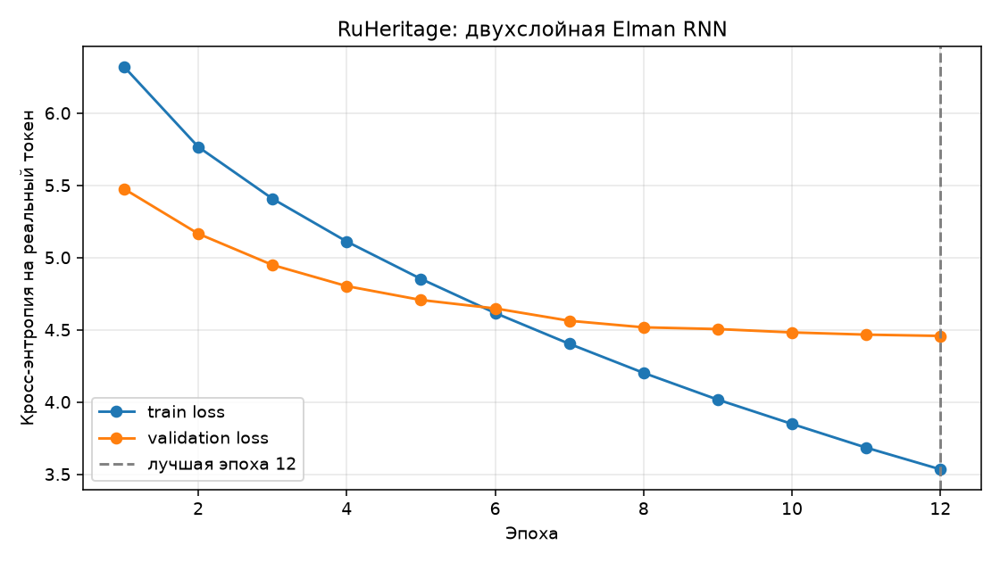
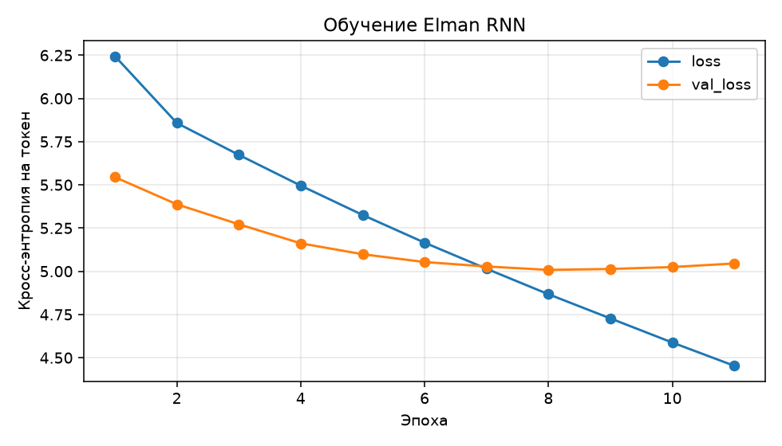

# Отчёт: языковая модель следующего слова на Elman RNN

## Цель и выполненные этапы

Реализована и обучена словарная языковая модель, предсказывающая следующий токен русского текста. Выполнены оба маршрута методички: сначала учебный пример на Gazeta, затем самостоятельная реализация на RuHeritage-Corpus. Основной результат — выполненный ноутбук `02_elman_rnn_language_model_completed.ipynb`; пример сохранён в `01_elman_rnn_language_model_example_executed.ipynb`. Исходные файлы не изменены.

Самостоятельно реализованы нормализация, потоковое ограниченное чтение, словарь, сдвинутые пары, Dataset, правое дополнение пакета, рекуррентный переход и два слоя Elman RNN, обучение AdamW, маскированная потеря, ранняя остановка, восстановление лучшей модели, оценка и генерация. Готовые рекуррентные слои RNN/GRU/LSTM не используются.

## Среда и параметры

Запуск выполнен на CPU, Python 3.12.14, PyTorch 2.13.0, NumPy 2.5.5, datasets 5.2.0; использованы 4 CPU-потока. Методичка рекомендует Python 3.13, фактический запуск использует Python 3.12. Это единственное отличие вычислительной среды, затрагивающее версию Python; гиперпараметры самостоятельного варианта не уменьшались. Зафиксированы генераторы Python, NumPy и PyTorch, SEED=42 и детерминированные операции PyTorch. Полные версии основных зависимостей записаны в `requirements.txt`. Побитовая идентичность между разными платформами и версиями библиотек не обещается.

| Параметр | Значение |
|---|---|
| Корпус | maxzt/RuHeritage-Corpus |
| Ревизия | `b2d01eaad3ddb119fe10c4cb17a86e47415a77cb` |
| Каталог / split / поле | data / train / text |
| Просматриваемые записи | Первые 1 200 |
| Максимум слов документа | 160 |
| Обычные слова словаря | Не более 6 000 |
| Специальные токены | PAD=0, UNK=1, BOS=2, EOS=3 |
| Длина входного окна | До 32 токенов |
| Embedding / hidden / слои | 128 / 128 / 2 |
| Размер пакета | 64 |
| Оптимизатор | AdamW, lr=0.002, weight_decay=0.0001 |
| Ограничение нормы градиента | 1.0 |
| Максимум эпох / patience | 12 / 3 |

## Данные и проверка разбиения

Поток прочитан через `load_dataset` с закреплённой ревизией, `data_dir="data"`, `split="train"`, `streaming=True`. Просмотрено 1200 записей; пригодны все 1200, исключено 0. Поэтому расхождение формулировок «первые 1 200 записей» в ноутбуке и «1 200 пригодных документов» в PDF на фактическую выборку не повлияло.

Текст приводится к нижнему регистру; регулярное выражение выделяет русские слова, включая ё и один внутрисловный дефис. Числа, латиница и пунктуация исключаются. После этого берутся первые 160 токенов. Пригодным считается документ минимум из двух токенов. Каждый шестой пригодный документ (6-й, 12-й и далее) отправляется в валидацию. Частоты слов считаются только после этого и только по обучающим документам.

| Показатель | Обучение | Валидация |
|---|---:|---:|
| Документы | 1000 | 200 |
| Слова после ограничения | 154443 | 31216 |
| Фрагменты-окна | 5792 | 1170 |
| Реальные целевые позиции, включая EOS | 155443 | 31416 |
| Доля UNK среди слов, без BOS/EOS/PAD | 23.4002% | 28.7673% |

Размер словаря — **6004** токена. SHA-256 последовательности выбранных нормализованных префиксов и их индексов: `5e19a9967e50a07821239a2ec52e3d9fc703050a9bda740f1f5c75fdce524475`. Исходные тексты корпуса не сохранялись в папку работы; сохранены словарь, небольшие примеры и агрегированные показатели.

Примеры нормализованных токенов:

1. михаил, ломоносов, полидор, идиллия, м, в, ломоносов, избранные, произведения, библиотека, поэта, большая, серия, л, с, подготовка.
2. википроекты, данные, примечания, эпиграмма, метит, не, только, в, кн, шихматова, как, толкует, ее, л, н, майков.
3. другие, редакции, в, дореформенной, орфографии, стихотворения, в, а, жуковский, в, воспоминаниях, современников, м, наука, школа, языки.

**Ограничение оценки:** обнаружено **47 уникальных совпадающих нормализованных префиксов** между обучением и валидацией. Это число различных совпавших текстов, а не обязательно число документов. Индексы документов не пересекаются, однако контент частично повторяется. Разбиение сохранено по заданию; валидацию нельзя считать полностью независимой по произведениям или авторам. Для строгой последующей оценки нужны удаление дублей и групповое разбиение, что уже изменит заданный эксперимент.

Начальные фрагменты включают библиографию, редакционные сведения и служебные слова («википроекты», «данные», «примечания»). Модель учит не только художественную прозу, но и такие текстовые закономерности.

## Пара «вход — цель» и мини-пакет

Собственный пример из первого документа: михаил ломоносов полидор.

- Вход: `<bos>, михаил, ломоносов, полидор`.
- Цель: `михаил, ломоносов, полидор, <eos>`.

Цель всегда сдвинута на одну позицию. Длинный документ разбивается на окна до 33 индексов до сдвига, поэтому вход и цель содержат до 32 индексов. Соседние окна имеют общий граничный токен, но каждый целевой переход учитывается ровно один раз. Документы между собой не склеиваются.

| Объект | Форма диагностического мини-пакета | Смысл |
|---|---|---|
| input_ids / target_ids | (64, 32) | Индексы прочитанного / следующего токена |
| Эмбеддинги | (64, 32, 128) | Вектор текущего слова |
| Состояния | (64, 32, 128) | Контекст верхнего рекуррентного слоя |
| Логиты | (64, 32, 6004) | Оценки всех токенов на каждой позиции |
| Логиты перед loss | (2048, 6004) | Позиции объединены в одну ось |
| Цели перед loss | (2048,) | Индекс правильного класса на позиции |

В диагностическом пакете 1 732 реальные цели из 2 048 позиций. Короткие строки дополняются нулём только справа. Размер B последнего пакета может быть меньше 64, а T определяется максимальной длиной внутри пакета.

## Архитектура и вычисления

$$h_t^{(l)}=\tanh(x_t^{(l)}(W_x^{(l)})^T+h_{t-1}^{(l)}(U_h^{(l)})^T+b_h^{(l)}).$$

У первого слоя вход — эмбеддинг, у второго — новое состояние первого слоя на той же позиции. Каждый слой имеет собственные Wₓ, Uₕ и bₕ, но один и тот же набор его весов применяется ко всем временным позициям. Начальные состояния нулевые для каждого окна; перенос памяти между окнами не выполняется. Выходной Linear(128,V) создаёт логиты.

Число параметров — **1,608,820**: таблица эмбеддингов 6004×128, два блока по (128×128+128×128+128), выходная матрица 6004×128 и выходное смещение 6004. Проверены формы, соответствие перехода формуле, причинность (будущие токены не меняют выходы прошлого) и наличие конечных градиентов у всех обучаемых блоков.

## Потеря, обучение и контроль

$$L=\frac{\sum_{b,t:y_{b,t}\ne PAD}-\log p(y_{b,t}\mid x_{b,\le t})}{\#\{(b,t):y_{b,t}\ne PAD\}},\qquad PPL=e^L.$$

`CrossEntropyLoss(ignore_index=0, reduction="sum")` принимает логиты, а не готовый softmax. Для backward сумма делится на количество реальных целей пакета. Для метрики эпохи суммируются потери и числа токенов всех пакетов отдельно; среднее средних не используется.

Последовательность обучения: zero_grad → forward → loss → backward → clip_grad_norm → AdamW.step. На валидации отключены градиенты и отсутствует шаг оптимизатора; отсутствие изменения параметров проверено сравнением снимков. Потеря с маской сопоставлена с явным отбором реальных позиций. Изменение логитов PAD-позиций не изменяет потерю. PAD-строка эмбеддингов остаётся нулевой.

Лучшие веса выбираются по минимуму validation loss, сохраняются на диск и загружаются обратно. Проверено совпадение повторной оценки со значением лучшей эпохи.

## Результат самостоятельного эксперимента

До обучения validation loss=8.778181, PPL=6491.06. Обучение завершило все **12 эпох**; ранняя остановка не потребовалась, потому что валидационная потеря продолжала улучшаться. Лучшей стала **эпоха 12**: **validation loss=4.457040, PPL=86.231861**.

| Эпоха | Train loss | Validation loss |
|---:|---:|---:|
| 1 | 6.320651 | 5.475197 |
| 2 | 5.765453 | 5.164517 |
| 3 | 5.406708 | 4.948263 |
| 4 | 5.110579 | 4.801859 |
| 5 | 4.851853 | 4.705931 |
| 6 | 4.615735 | 4.647368 |
| 7 | 4.402170 | 4.561941 |
| 8 | 4.201175 | 4.516531 |
| 9 | 4.015804 | 4.504503 |
| 10 | 3.847508 | 4.481314 |
| 11 | 3.683405 | 4.465967 |
| 12 | 3.533109 | 4.457040 |

Потери обеих частей в целом снижаются; к концу обучения обучающая потеря заметно ниже валидационной, а улучшения валидации замедляются. Это указывает на ограниченность обобщения; не доказывает независимого качества на новых произведениях. Большая доля UNK и пересекающиеся префиксы дополнительно ограничивают интерпретацию PPL.

### Top-5 следующего токена

Каждый список получен из softmax логитов последней позиции. Специальные токены не скрывались, распределение не перенормировывалось после фильтрации. Сумма пяти показанных вероятностей обычно меньше единицы, потому что остальные токены тоже имеют ненулевые вероятности.

**Запрос: «однажды вечером»**

| Токен | Вероятность |
|---|---:|
| `<unk>` | 0.183049 |
| `и` | 0.132371 |
| `первая` | 0.112503 |
| `я` | 0.083085 |
| `о` | 0.061969 |

**Запрос: «я не знаю»**

| Токен | Вероятность |
|---|---:|
| `в` | 0.071018 |
| `<unk>` | 0.067227 |
| `ни` | 0.043548 |
| `не` | 0.043420 |
| `что` | 0.039196 |

**Запрос: «он сказал»**

| Токен | Вероятность |
|---|---:|
| `<unk>` | 0.237824 |
| `что` | 0.179157 |
| `по` | 0.041460 |
| `в` | 0.038293 |
| `из` | 0.034900 |

**Запрос: «михаил ломоносов полидор»**

| Токен | Вероятность |
|---|---:|
| `идиллия` | 0.193393 |
| `сочинений` | 0.039253 |
| `литература` | 0.018271 |
| `и` | 0.017156 |
| `данные` | 0.017067 |

Продолжение «идиллия» после «михаил ломоносов полидор» соответствует обучающему фрагменту и показывает усвоение локального сочетания, но не является проверкой на новом тексте. Для «он сказал» токен «что» выглядит правдоподобно, однако самый вероятный ответ — UNK.

### Жадная генерация

На каждом шаге выбран argmax без ручной замены слов. Для каждого запроса лимит — 16 новых токенов; во всех трёх показанных генерациях сработал лимит, а не EOS.

Запрос «однажды вечером»:

`однажды вечером <unk> <unk> <unk> <unk> <unk> <unk> <unk> <unk> <unk> <unk> <unk> <unk> <unk> <unk> <unk> <unk>`

Запрос «я не знаю»:

`я не знаю в <unk> <unk> <unk> <unk> <unk> <unk> <unk> <unk> <unk> <unk> <unk> <unk> <unk> <unk> <unk>`

Запрос «он сказал»:

`он сказал <unk> <unk> <unk> <unk> <unk> <unk> <unk> <unk> <unk> <unk> <unk> <unk> <unk> <unk> <unk> <unk>`

Повторение UNK — реальный результат этой модели. Около 28.77% слов валидации отображаются в один класс UNK, поэтому ему выгодно присваивать высокую вероятность. Жадный выбор закрепляет такое продолжение. Потеря снизилась, но связная генерация не достигнута; её нельзя считать успешной только на основании конечной PPL. Возможные отдельные дальнейшие эксперименты — другая токенизация, очистка служебного текста, более крупная выборка и иное декодирование; в данной работе они не подменяли обязательный опыт.

## Выполненный пример на Gazeta

Прочитаны первые 1 200 документов Gazeta v1.0, поле text; train/val=1000/200, фрагменты=5999/1200, словарь=6004. Выполнено 11 эпох; ранняя остановка после трёх эпох без улучшения. Лучшая эпоха — 8, validation loss=5.008068, PPL=149.615336.

Для совместимости с datasets 5.2.0 встроенный JSON-загрузчик читает `gazeta_train.jsonl` из той же закреплённой v1.0 вместо выполнения старого загрузочного скрипта. Поле, порядок записей, размеры и гиперпараметры сохранены. Имеющееся в примере ограничение показателя exp заменено на точное exp(loss); на наблюдавшихся потерях это не меняет чисел.

Пример использует исходное разбиение с нулевой нумерацией документов 0,6,12,…; самостоятельный вариант — каждый шестой пригодный документ, считая с единицы. Это отражает различие инструкций соответствующих ноутбуков. Поскольку корпуса, частоты, словари и разбиения различны, меньшая численная PPL RuHeritage не доказывает, что модель на нём «лучше» модели Gazeta.

## Что сохранено и проверено

- Выполненные копии обоих ноутбуков с выводами и графиками.
- Лучшие веса, словарь, история и сводные метрики в `artifacts/assignment/` и `artifacts/example/`.
- Параметры эксперимента и статистика данных для самостоятельного задания.
- Полный ответ на 10 контрольных вопросов лабораторной и дополнительные вопросы лекции — ниже и в `Контрольные вопросы.md`.
- Личный краткий конспект — `Краткий конспект.md`.
- Инструкция повторного запуска — `README.md`; версии зависимостей — `requirements.txt`.

Все кодовые ячейки выполнены сверху вниз. Проверены формы и индексы, правильность сдвига, отсутствие пропусков и повторного учёта целевых переходов, правое дополнение, независимость словаря от валидационных частот, исключение PAD из потери, обратный проход, конечность метрик и восстановление лучших весов. Независимость содержания train/val не утверждается: обнаруженные совпадения явно отмечены выше.

## Ответы на контрольные вопросы

## Вопросы лабораторной

1. **Почему индекс токена нельзя подавать как обычное вещественное число?** Индекс — произвольный идентификатор. Разность между индексами не измеряет смысловую близость: перестановка словаря не должна менять смысл слов. Embedding превращает идентификатор в обучаемый вектор признаков.

2. **Почему словарь строится только по обучающим документам?** Иначе состав словаря и частоты будут зависеть от отложенной выборки. Это утечка информации в предобработку. Незнакомые слова валидации отображаются в UNK; словарь не расширяется.

3. **Какие пары получаются из (BOS, a, b, EOS)?** Вход — (BOS, a, b), цель — (a, b, EOS). На каждой позиции нужно предсказать следующий токен, а не повторить текущий.

4. **Чем PAD отличается от UNK?** PAD означает отсутствующую позицию, добавленную для выравнивания длины; UNK — настоящее слово, которого нет в ограниченном словаре. PAD исключается из потери, UNK остаётся целью. Если исключить UNK, модель перестанет отвечать за часть реальных слов.

5. **Какова форма логитов?** (B,T,V): для каждого из B фрагментов, на каждой из T позиций выдаётся оценка каждого из V токенов. Для CrossEntropyLoss формы преобразуются в (B·T,V) и (B·T).

6. **Почему целевые индексы подходят для CrossEntropyLoss?** На каждой позиции решается задача классификации следующего токена по V классам. Цель — индекс правильного класса-токена; наличие или отсутствие метки всего документа не имеет значения.

7. **Что произойдёт при включении PAD в потерю?** Модель будет вознаграждаться за предсказание технических нулей. Оценка станет зависеть от количества дополнения и состава пакета, а обучение потратит часть усилий на фиктивную задачу. Правильный знаменатель — число целей, не равных PAD.

8. **Что обновляет optimizer.step()?** Таблицу эмбеддингов, входные и рекуррентные матрицы и смещения обоих слоёв, выходную матрицу и её смещение. Индексы, цели, маски и размеры тензоров не обновляются. Скрытые состояния — промежуточные вычисления, а не отдельные параметры. PAD-строка эмбеддинга изначально нулевая и не получает градиент; при используемом AdamW остаётся нулевой, что проверено.

9. **Почему PPL сравнивается при одинаковых словаре и токенизации?** Кросс-энтропия определяется на токен, а токенизация и словарь определяют сами события, множество классов и долю UNK. При разных словарях PPL относятся к разным задачам. Поэтому результаты Gazeta и RuHeritage нельзя ранжировать как честное сравнение качества двух моделей.

10. **Что означают оси (B,T,128)?** B — независимые последовательности мини-пакета, T — позиции внутри каждой последовательности, 128 — координаты вектора признаков на позиции. Два рекуррентных слоя не означают отдельную ось размера 2 в выходе: наружу возвращается последовательность состояний верхнего слоя.

## Дополнительные вопросы из теоретического пособия

1. **Что хранит скрытое состояние и зачем нулевое начальное состояние?** hₜ — обучаемое сжатое представление прочитанного префикса. Нулевое h₀ задаёт единое начало без накопленного контекста. В этой работе h₀ сбрасывается для каждого окна: модель не переносит память между окнами.

2. **Почему веса в пакетной формуле транспонируются?** Параметр W хранится как (выходные признаки, входные признаки), а пакет X — как (объекты, входные признаки). Поэтому XWᵀ имеет нужную форму (объекты, выходные признаки); это та же операция, что Wx для одного вектора-столбца.

3. **Зачем ModuleList?** Он регистрирует вложенные модули: их параметры видны в model.parameters(), state_dict() и при переносе устройства. Обычный список Python сам по себе такой регистрации не обеспечивает.

4. **Почему перед CrossEntropyLoss не нужен softmax?** Функция принимает логиты и сама вычисляет устойчивый log-softmax с отрицательным логарифмом вероятности правильного класса. Если заранее передать вероятности, функция ошибочно воспримет их как логиты. Softmax отдельно нужен при интерпретации прогноза.

5. **Чем отличаются Dataset и DataLoader?** Dataset возвращает один пример — пару вход/цель. DataLoader выбирает и при необходимости перемешивает примеры, собирает мини-пакеты и вызывает collate_fn. Последняя дополняет короткие последовательности справа.

6. **Почему трудно учить далёкие зависимости?** При обратном распространении через время многократно перемножаются матрицы и производные tanh. Градиенты могут затухать или расти, а фиксированное состояние ограничивает память. Clipping ограничивает взрыв градиента, но не устраняет затухание и не увеличивает длину контекста.

## Источники

Локальные условия: `lab_rnn.pdf`, теоретическое пособие `theory_rnn.pdf` и оба исходных ноутбука в этой папке. Использованные изображения извлечены из предоставленной методички для восстановления локальных ссылок примера. Данные: [RuHeritage, закреплённая ревизия](https://huggingface.co/datasets/maxzt/RuHeritage-Corpus/tree/b2d01eaad3ddb119fe10c4cb17a86e47415a77cb/data), [Gazeta v1.0](https://huggingface.co/datasets/IlyaGusev/gazeta/tree/v1.0).
